## `$ whoami`

Étudiant en **2e année de Bachelor à l'IPSSI Lille**, venu du développement web et passionné par le **DevOps**. J'ai monté un homelab Proxmox pour m'entraîner en conditions réelles.

Je recherche une **alternance à partir de septembre 2027** en DevOps, administration systèmes et réseaux, cloud ou support IT.

## `$ ./homelab --map`

## `$ skills --status`

**Légende :** 🟢 pratiqué · 🟡 notions ou en apprentissage

<b>🖥️ Systèmes et virtualisation</b>

| Compétence | Niveau | Ce que je fais avec / contexte |
|---|:---:|---|
| Linux (Debian, Ubuntu) | 🟢 | Systèmes du quotidien et du homelab |
| Windows, Windows Server | 🟢 | Installation, configuration et mises à jour de systèmes (stage 2022, Windows Server dans ma stack) |
| Proxmox VE, LXC | 🟢 | Serveur personnel : machines virtuelles et conteneurs |
| Bash | 🟢 | Scripts et administration |
| Dépannage matériel et logiciel | 🟢 | Stage technique au Centre Lazare Garreau |

<b>🌐 Réseau et sécurité</b>

| Compétence | Niveau | Ce que je fais avec / contexte |
|---|:---:|---|
| Modèle OSI, TCP/IP, adressage et sous-réseaux | 🟢 | Fondamentaux réseau |
| DNS, DHCP, HTTP/HTTPS, SSH | 🟢 | Services et protocoles courants |
| Routage (CCNA 1), nginx | 🟢 | Routage et service web |
| Cloudflare Tunnels / Zero Trust, reverse proxy | 🟢 | Exposition sécurisée des services du homelab |
| Pare-feu | 🟡 | Notions |

<b>🐳 Conteneurs et DevOps</b>

| Compétence | Niveau | Ce que je fais avec / contexte |
|---|:---:|---|
| Docker, Docker Compose | 🟢 | Application conteneurisée en architecture multi-images (stage Le 44) |
| Portainer | 🟢 | Gestion de conteneurs |
| Kubernetes (K3s) | 🟡 | Cluster léger sur le homelab, en autoformation |
| Terraform | 🟡 | Expérimentations d'infrastructure as code |
| Ansible | 🟡 | En apprentissage sur le homelab |
| GitLab CI/CD | 🟡 | Contrôles automatisés de qualité, en autoformation |

<b>💻 Développement</b>

| Compétence | Niveau | Ce que je fais avec / contexte |
|---|:---:|---|
| PHP, Symfony, API Platform | 🟢 | Back-end et API |
| Python, SQL | 🟢 | Programmation et bases de données |
| JavaScript, HTML/CSS | 🟢 | Interfaces web |
| TypeScript | 🟡 | En apprentissage |
| Back-office, comptes utilisateurs, réservation | 🟢 | Réalisés pour le restaurant Le 44 |

## `$ cat experiences.log`

### 🍽️ Stagiaire développeur web · Restaurant Le 44, Seclin · 2026 (3 mois)
- Conteneurisation de l'application avec **Docker** (architecture multi-images)
- Interface d'administration pour gérer la carte et la galerie photos
- Comptes utilisateurs avec modification de profil sécurisée
- Réservation de tables avec envoi des données au tableau de bord

### 🔧 Stagiaire technique · Centre Lazare Garreau · 2022 (1 mois)
- Diagnostic et résolution de pannes matérielles et logicielles
- Installation, configuration et mise à jour de systèmes et de logiciels

## `$ sudo apt upgrade younes` · Ma formation à l'IPSSI Lille

Mon Bachelor informatique se poursuit sur deux années à l'IPSSI. Voici le programme, expliqué simplement.

| Année | Quand | Format | Objectif |
|---|---|---|---|
| **Bachelor 2** (en cours) | 2026-2027 | Cours + stage de 2 à 6 mois | Consolider les bases techniques |
| **Bachelor 3** (à venir) | 2027-2028 | Alternance : 3 semaines en entreprise, 1 à l'école | Me spécialiser et obtenir un titre Bac+3 |

### 📗 2e année : construire les bases

| Domaine | En clair | Au programme |
|---|---|---|
| 🖥️ Systèmes | Installer et gérer des serveurs | Windows Server 2022, Linux, scripts Bash |
| 📦 Virtualisation | Faire tourner plusieurs serveurs sur peu de machines | Cluster Proxmox, systèmes répartis |
| 🌐 Réseaux | Relier les machines entre elles | Architectures avancées Cisco |
| ☁️ Cloud | Héberger des services en ligne | AWS |
| 🔐 Sécurité | Trouver les failles et les éviter | Tests d'intrusion, OWASP, code sécurisé |
| 💻 Développement | Créer des applications web | API, React, PHP 8, tests, bases de données |
| 📊 Data et IA | Exploiter les données | Big data, OpenAI, Hugging Face |

### 📘 3e année : option visée, Cybersécurité & Cloud Computing

| Domaine | En clair | Au programme |
|---|---|---|
| 🖥️ Administration avancée | Gérer et automatiser les serveurs | Windows Server, PowerShell, cluster Linux, Ansible |
| 📦 Virtualisation | Maîtriser les hyperviseurs | ESXi, Hyper-V, Proxmox |
| 🌐 Réseaux | Concevoir et découper un réseau d'entreprise | Cisco, TCP/IP, segmentation |
| ☁️ Cloud | Déployer chez les grands fournisseurs | Azure, AWS |
| 📈 Exploitation | Surveiller et éviter les pannes | Supervision, haute disponibilité, gestion de parc |
| 🔐 Sécurité | Intégrer la sécurité à chaque étape | Tests d'intrusion, DevSecOps |
| 🤝 Projet | Travailler en équipe | Gestion de projet |

🎓 **Titre visé :** Administrateur d'infrastructures sécurisées (niveau 6, Bac+3).

> Ces modules sont ceux du programme de l'école. Ils ne comptent pas encore parmi mes acquis.

## `$ ./carriere.sh` · Les métiers possibles

### 🚀 Après le Bac+3

| Métier | Ce qu'on y fait |
|---|---|
| Administrateur systèmes et réseaux | Faire fonctionner les serveurs et le réseau d'une entreprise |
| Administrateur d'infrastructures et cloud | Gérer des serveurs sur place et en ligne |
| Administrateur cybersécurité | Protéger les systèmes et réagir aux incidents |
| Technicien support IT | Dépanner et accompagner les utilisateurs |

### 🔭 Ensuite, avec un Mastère et/ou de l'expérience

| Métier | Ce qu'on y fait |
|---|---|
| **Ingénieur DevOps / SRE** (mon objectif) | Automatiser les déploiements et garder les services disponibles |
| Architecte cloud | Concevoir l'hébergement en ligne d'une entreprise |
| Pentester | Tester la sécurité en simulant des attaques autorisées |
| Expert DevSecOps | Intégrer la sécurité dans la chaîne de livraison |
| Responsable infrastructure | Piloter les systèmes, les réseaux et les choix techniques |

📚 **Poursuite possible :** à l'IPSSI, un Mastère (Bac+5) en Cybersécurité & Cloud ou en Big Data, IA & Dév.

## `$ git log --graph`

## `$ pipeline`

<b>📋 TODO.md : mes prochains objectifs</b>

**Court terme**
- [ ] Décrocher une alternance DevOps / SysAdmin / Cloud
- [ ] Automatiser le provisionnement du homelab avec Terraform et Ansible
- [ ] Déployer des services hautement disponibles sur K3s
- [ ] Progresser en TypeScript et React

**Moyen terme**
- [ ] Observabilité : Prometheus, Grafana, Loki et alertes
- [ ] Pipelines CI/CD complets : build, tests, scans de sécurité, déploiement
- [ ] Images système immuables avec Packer

**Long terme**
- [ ] Cloud public (AWS, GCP, Azure) et DevSecOps
- [ ] Une certification : CKA, Terraform Associate ou AWS
- [ ] Devenir ingénieur DevOps / SRE

<b>⚙️ principes.conf</b>

1. **Automatiser :** une tâche faite deux fois à la main mérite un script.
2. **Pratiquer :** un homelab qui tourne vaut mieux qu'un tutoriel théorique.
3. **Casser, lire les logs, réparer :** chaque incident rend plus solide.
4. **Rester propre :** une infrastructure reproductible, documentée et sécurisée.
5. **Comprendre les développeurs :** rester proche du code.

🗣️ Français (langue maternelle) · Anglais · Arabe  
🥊 Sports de combat · 🎬 Cinéma · ✈️ Voyages

