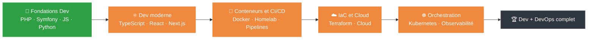

<!--
  A VERIFIER AVANT DE PUBLIER :
  1. Le lien LinkedIn (section Contact) : verifie qu'il ouvre bien ton profil.
  2. Mets a jour la ROADMAP au fil de ton avancee (legende dans la section dediee).
  3. Ne touche pas aux balises waka (START_SECTION / END_SECTION) : WakaTime les met a jour tout seul.
  4. Ce depot doit s'appeler exactement comme ton pseudo (Yns59/Yns59) pour s'afficher sur ton profil.
-->

<div align="center">


<a href="https://git.io/typing-svg">
  
</a>

<br/><br/>


</div>

---

# Hey, moi c'est Younes 👋

Étudiant en **Bachelor Informatique à l'école Enigma** (2ème année), passionné par la création d'applications web .  
J'aime apprendre, construire, casser des trucs, et recommencer jusqu'à ce que ce soit propre. 💪  
Et quand je ne code pas… je plonge dans le **DevOps** : j'ai monté mon propre **homelab** (serveurs, virtualisation, automatisation) pour m'entraîner en autodidacte, parce que comprendre l'infra, les conteneurs et les pipelines, ça rend un développeur vraiment complet.

> *"Le meilleur moyen d'apprendre, c'est de faire."*

---

## 🔥 Mon ambition

Je ne vise pas juste « un bon niveau ». **Je veux devenir le meilleur développeur que je puisse être**, et la meilleure version de moi-même, un jour de travail après l'autre.

| 📍 Aujourd'hui | 🚀 Demain | 🏆 Objectif |
|:---|:---|:---|
| **Bachelor Informatique** (2ème année), dev web **PHP / Symfony**, un stage web réalisé | **TypeScript → React → Next.js** pour un front moderne | Développeur **full-stack avec une vraie culture DevOps** |
| **Docker en conditions réelles**, premiers pas en CI/CD, Terraform et Kubernetes | Automatiser, déployer, industrialiser | Savoir construire **et** faire tourner mes applications |

> 💡 **1 % de mieux chaque jour = environ ×37 en un an.**  
> Je ne cherche pas la perfection du premier coup, je cherche la progression, tous les jours.

---

## 🚀 Ce qui m'anime

- 🎓 Étudiant en informatique, toujours en train d'apprendre quelque chose de nouveau
- 💡 Passionné par le **développement d'applications web**, du backend propre au frontend soigné
- 🛠️ Passionné de **DevOps** : Docker, CI/CD, automatisation, bonnes pratiques d'infrastructure
- 🏠 Un **homelab perso** pour tester, casser et reconstruire des environnements
- 🔨 J'ai toujours un projet en cours dans un coin de ma tête (ou de mon bureau)
- 📈 En constante progression : chaque projet est une occasion de monter en compétences
- 🤝 **À la recherche d'une alternance** pour mettre mes compétences au service de projets concrets
- 🎯 **Prochaines étapes :** apprendre **TypeScript**, **React** et **Next.js**, parce que la curiosité ne s'arrête jamais

---

## 🧭 Mon parcours

| 📅 Période | 📍 Où | 📝 Ce que j'y ai fait |
|:---|:---|:---|
| **2025 – 2028** | 🎓 **Bachelor Informatique**, École Supérieure des Sciences de l'Informatique (Enigma) | Web, réseaux, sécurité appliquée à l'IoT, objets connectés, domotique et IA, administration systèmes Windows / Linux, gestion de projet |
| **2026** (3 mois) | 💼 **Stage développeur web**, Restaurant Le 44 (Seclin) | Un site complet avec back-office, comptes utilisateurs et réservation de tables, déployé sous Docker (détails ci-dessous) |
| **2022** (1 mois) | 🔧 **Stage technique**, Centre Lazar Garreau | Dépannage matériel et logiciel, installation, configuration et mise à jour de systèmes d'exploitation et de logiciels |
| **2023 – 2024** | 📜 **Baccalauréat**, mention Assez Bien | |

### 💼 Ce que j'ai livré en stage

- 🐳 **Déploiement et DevOps :** conteneurisation de l'application sous **Docker** (architecture multi-images) pour un environnement isolé et propre
- 🗂️ **Back-office et CRUD :** interface administrateur pour gérer dynamiquement le contenu du site (menus à la carte, galerie de photos)
- 🔐 **Gestion des utilisateurs :** système de comptes avec modification de profil sécurisée
- 📅 **Système de réservation :** module de réservation de tables, avec transmission automatique des données (nom, prénom, couverts) vers le tableau de bord de l'administrateur

---

## ⌨️ Ma stack

**Ce que j'utilise**


**Ce que j'explore côté DevOps et systèmes**


**Ce que j'apprends maintenant** 🌱


---

## 🗺️ Ma roadmap : de Dev à DevOps

> Je documente ma progression pour rester honnête avec moi-même, et pour que tu voies où j'en suis.

**Légende :** ✅ Acquis · 🔄 En cours · 🎯 Prochain objectif · ⏳ Plus tard

<!--
  COMMENT METTRE A JOUR LA ROADMAP :
  - Change l'emoji de statut (🎯 -> 🔄 -> ✅).
  - Ajuste la barre : 10 blocs, ▰ = rempli, ▱ = vide (ex. 40 % = ▰▰▰▰▱▱▱▱▱▱).
  - Mets aussi a jour le schema Mermaid plus bas (classes done / wip / todo).
-->



### 🧱 Phase 1 : Fondations du développeur

| Statut | Compétence | Progression |
|:---:|:---|:---|
| ✅ | HTML / CSS | `▰▰▰▰▰▰▰▰▱▱` 80 % |
| 🔄 | JavaScript | `▰▰▰▰▰▰▱▱▱▱` 60 % |
| 🔄 | PHP | `▰▰▰▰▰▰▰▱▱▱` 70 % |
| 🔄 | Symfony et architecture MVC | `▰▰▰▰▰▱▱▱▱▱` 50 % |
| 🔄 | Python | `▰▰▰▰▱▱▱▱▱▱` 40 % |
| 🔄 | Bases de données (SQL) | `▰▰▰▰▰▱▱▱▱▱` 50 % |
| 🔄 | Git et workflow collaboratif | `▰▰▰▰▰▰▱▱▱▱` 60 % |

### ⚛️ Phase 2 : Développement moderne *(mon focus actuel)*

| Statut | Compétence | Progression |
|:---:|:---|:---|
| 🔄 | **TypeScript** | `▰▱▱▱▱▱▱▱▱▱` 10 % |
| 🎯 | **React** | `▱▱▱▱▱▱▱▱▱▱` 0 % |
| 🎯 | **Next.js** | `▱▱▱▱▱▱▱▱▱▱` 0 % |

### 🐳 Phase 3 : Conteneurs, CI/CD et automatisation

| Statut | Compétence | Progression |
|:---:|:---|:---|
| 🔄 | Docker et Docker Compose (déjà utilisé en stage) | `▰▰▰▰▰▱▱▱▱▱` 50 % |
| 🔄 | Linux et scripting Bash | `▰▰▰▰▱▱▱▱▱▱` 40 % |
| 🔄 | Homelab perso (serveurs, virtualisation, automatisation) | `▰▰▰▰▱▱▱▱▱▱` 40 % |
| 🔄 | Pipelines CI/CD (GitLab CI, GitHub Actions) | `▰▰▱▱▱▱▱▱▱▱` 25 % |

### ☁️ Phase 4 : Infrastructure as Code et Cloud

| Statut | Compétence | Progression |
|:---:|:---|:---|
| 🔄 | Terraform (HCL) | `▰▰▱▱▱▱▱▱▱▱` 20 % |
| 🎯 | Ansible | `▱▱▱▱▱▱▱▱▱▱` 0 % |
| 🎯 | Un cloud provider (AWS / Azure / GCP) | `▱▱▱▱▱▱▱▱▱▱` 0 % |

### ☸️ Phase 5 : Orchestration et observabilité

| Statut | Compétence | Progression |
|:---:|:---|:---|
| 🔄 | Kubernetes (en autoformation) | `▰▱▱▱▱▱▱▱▱▱` 10 % |
| ⏳ | Monitoring (Prometheus / Grafana) | `▱▱▱▱▱▱▱▱▱▱` 0 % |
| ⏳ | GitOps (ArgoCD / Flux) | `▱▱▱▱▱▱▱▱▱▱` 0 % |

### 🏆 Phase 6 : Excellence

| Statut | Compétence | Progression |
|:---:|:---|:---|
| 🔄 | Sécurité : DevSecOps, en m'appuyant sur ma base sécurité IoT | `▰▱▱▱▱▱▱▱▱▱` 10 % |
| ⏳ | Tests automatisés et qualité de code | `▱▱▱▱▱▱▱▱▱▱` 0 % |
| ⏳ | Certification cloud / DevOps | `▱▱▱▱▱▱▱▱▱▱` 0 % |
| ⏳ | Contribuer à un projet open source | `▱▱▱▱▱▱▱▱▱▱` 0 % |

**📊 Progression globale :** `▰▰▰▱▱▱▱▱▱▱` ~30 %

---

## 🎯 Mes objectifs

**✅ Déjà accompli**
- [x] Réaliser un **stage de développeur web** (3 mois) : site complet, back-office, réservation
- [x] **Conteneuriser** une vraie application sous Docker (architecture multi-images)
- [x] Monter mon propre **homelab** pour m'entraîner en autodidacte

**🔥 Court terme**
- [ ] Décrocher une **alternance** pour progresser sur du concret
- [ ] Avoir des bases solides en **TypeScript**
- [ ] Construire un premier projet **React**
- [ ] Mettre en place un pipeline **CI/CD** complet

**🚀 Moyen terme**
- [ ] Livrer une application **full-stack Next.js** déployée en ligne
- [ ] Provisionner toute une infra avec **Terraform**
- [ ] Faire tourner une vraie application sur **Kubernetes**

**🏆 Long terme**
- [ ] Maîtriser l'**observabilité** (monitoring, logs, alertes)
- [ ] Obtenir une **certification** cloud / DevOps
- [ ] Devenir un développeur **full-stack complet, avec une vraie culture DevOps**

---

## 💪 Mes principes

1. **Apprendre chaque jour**, même 30 minutes.
2. **Construire plutôt que regarder** : un projet vaut mille tutos.
3. **Casser, comprendre, recommencer** : l'erreur fait partie du chemin.
4. **Viser propre** : un code lisible, une infra reproductible.
5. **Ne jamais s'arrêter** : la curiosité n'a pas de ligne d'arrivée.

---

## 🛠️ En ce moment

- 🌱 J'approfondis mes connaissances en **Symfony** et architecture MVC
- 🔷 Je me forme à **TypeScript**, avant de passer à **React** puis **Next.js**
- 🐳 J'avance sur **Docker, CI/CD (GitLab, GitHub Actions), Terraform et Kubernetes** pour la partie DevOps
- 🏠 Je fais évoluer mon **homelab** pour tester de nouveaux outils
- 🧪 J'explore le développement d'applications web complètes, de la base de données à l'interface
- 💻 Je travaille sur des projets perso pour mettre en pratique ce que j'apprends
- 📚 Toujours un onglet de doc ouvert quelque part

<!--
  PROJETS EN VEDETTE (decommente et complete quand tu as quelque chose a montrer) :

  ## 📂 Projets en vedette

  | Projet | Description | Stack |
  |:---|:---|:---|
  | [Nom du projet](https://github.com/Yns59/nom-du-repo) | Ce qu'il fait, en une phrase | PHP · Symfony · Docker |
-->

---

## ⏱️ Mon temps de code (WakaTime)

<!--START_SECTION:waka-->

```txt
From: 18 June 2026 - To: 10 October 2026

Total Time: 68 hrs 36 mins

YAML                21 hrs 58 mins        ████████░░░░░░░░░░░░░░░░░   31.57 %
PHP                 14 hrs 8 mins         █████░░░░░░░░░░░░░░░░░░░░   20.32 %
JavaScript          8 hrs 14 mins         ███░░░░░░░░░░░░░░░░░░░░░░   11.83 %
Terraform           4 hrs 54 mins         █▓░░░░░░░░░░░░░░░░░░░░░░░   07.05 %
Docker              3 hrs 56 mins         █▒░░░░░░░░░░░░░░░░░░░░░░░   05.66 %
Bash                2 hrs 51 mins         █░░░░░░░░░░░░░░░░░░░░░░░░   04.11 %
HCL                 56 mins               ▒░░░░░░░░░░░░░░░░░░░░░░░░   01.34 %
```

<!--END_SECTION:waka-->

---

## 📊 Mes stats GitHub

<div align="center">


<br/>


<br/>


</div>

---

## 🌍 Au-delà du code

- 🗣️ **Langues :** 🇫🇷 Français (langue maternelle)  · 🌍 Arabe
- 🥊 Sport de combat : discipline, persévérance et humilité, des valeurs que je retrouve dans le code
- 🎬 Cinéma
- ✈️ Voyages

---

## 🤝 Travaillons ensemble

Je suis **à la recherche d'une alternance** en développement web / DevOps, sur Lille et ses environs. Passionné et proactif, je veux mettre mes compétences techniques (web, réseaux) au service de vos projets tout en renforçant mon expertise sur le terrain. Si tu as une opportunité ou juste envie d'échanger, écris-moi !

<div align="center">

[](https://www.linkedin.com/in/Younes-Gallouch)
[](mailto:gallouchy@gmail.com)

</div>

---

<div align="center">

### *« Je ne suis pas encore là où je veux être, mais je suis plus loin qu'hier. »* 🚀

*Profil en construction, comme moi.* 🚧


</div>
