<div align="center">



<br/><br/>

*« Le meilleur moyen d'apprendre, c'est de construire, casser et automatiser. »*

</div>

<br/>

## `whoami`

Je m'appelle **Younes**, étudiant en **Bachelor Informatique à l'école Enigma** (2ème année, Lille), passionné par l'**ingénierie DevOps, l'infrastructure système et l'automatisation**.

Mon moteur : comprendre **comment une application vit en production**, du serveur physique jusqu'au déploiement continu. Issu d'une base en développement web (PHP/Symfony, TypeScript), j'ai rapidement basculé du côté de l'infrastructure. Pour pratiquer en conditions réelles, j'ai monté mon propre **homelab sous Proxmox** afin d'administrer mes serveurs, segmenter mon réseau, conteneuriser mes services et automatiser mes déploiements en **Infrastructure as Code (IaC)**.

Je ne vise pas « un bon niveau ». Je vise **la fiabilité, la sécurité et la reproductibilité**, un jour de travail après l'autre.

> **1 % de mieux chaque jour = environ ×37 en un an.**
> Je ne cherche pas la perfection du premier coup, je cherche l'amélioration continue (comme un bon pipeline).

<br/>

## `stack.yml`

```yaml
# mon environnement de travail & homelab
infrastructure_&_devops:
  virtualisation_&_os: [Proxmox VE, Linux (Debian/Ubuntu), LXC, Windows Server, Bash]
  conteneurs:          [Docker, Docker Compose, Portainer, Kubernetes (K3s)]
  iac_&_config:        [Terraform, Ansible, Packer]
  ci_cd:               [GitLab CI/CD, GitHub Actions]
  reseau_&_securite:   [TCP/IP, DNS/DHCP, Routage (CCNA 1), Traefik, Cloudflare Tunnels / Zero Trust]

developpement:         # comprendre le code pour mieux le déployer
  backend:             [PHP, Symfony, Python, SQL]
  frontend_&_typing:   [JavaScript, TypeScript, HTML/CSS]

apprentissage:
  maintenant:          [Kubernetes (K3s), Ansible, TypeScript]
  ensuite:             [Observabilité (Prometheus, Grafana, Loki), React / Next.js]

domaines:
  - Administration systèmes & virtualisation (Homelab Proxmox)
  - Automatisation & Infrastructure as Code (Terraform, Ansible, CI/CD)
  - Sécurité des infrastructures, accès distants & architecture réseau
  - Conteneurisation et orchestration d'applications

langues:               [français (langue maternelle), anglais, arabe]
hors_prod:             [sport de combat, cinéma, voyages]
```

<br/>

## `pipeline`

Ma roadmap vers l'**ingénierie DevOps & Cloud**, présentée comme un pipeline CI/CD. Elle n'est pas figée : elle est **générée dynamiquement depuis [`roadmap.yml`](./roadmap.yml) par une GitHub Action**. Je modifie ma progression, je push, et le pipeline se reconstruit tout seul. (L'état d'esprit GitOps, appliqué à mon propre profil.)

<div align="center">



</div>

<br/>

## `CHANGELOG.md`

```text
du plus récent au plus ancien

2026 · Conception & Administration d'un Homelab DevOps (Projet continu)
  ├─ Virtualisation : déploiement et gestion d'un serveur sous Proxmox VE (VM & conteneurs LXC)
  ├─ Réseau & Sécurité : exposition sécurisée via Cloudflare Tunnels / Zero Trust et reverse proxy
  └─ Automatisation : expérimentations IaC (Terraform, Ansible) et cluster léger K3s

2026 · Stage Développeur Web & Conteneurisation — Restaurant Le 44, Seclin (3 mois)
  ├─ Docker : conteneurisation complète de l'application, architecture multi-conteneurs isolée
  ├─ Backend & BDD : développement du système de réservation et back-office d'administration
  └─ Sécurité : gestion des comptes utilisateurs et sécurisation des flux de données

2025 · Bachelor Informatique — École Supérieure des Sciences de l'Informatique (Enigma)
  └─ 2025 → 2028 : administration systèmes Linux / Windows, architecture réseaux (Cisco CCNA),
                   sécurité des SI, virtualisation, développement web et gestion de projet

2024 · Baccalauréat, mention Assez Bien

2022 · Stage Technique Systèmes — Centre Lazare Garreau (1 mois)
  └─ maintenance d'infrastructure matérielle et logicielle, déploiement et configuration d'OS
```

<br/>

## `TODO.md`

**Déjà accompli**
- [x] Monter et administrer mon propre **serveur Homelab sous Proxmox**
- [x] **Conteneuriser** une application complète en production sous **Docker** (architecture multi-images)
- [x] Sécuriser les accès réseau de mon lab (Cloudflare Zero Trust, isolation des services)
- [x] Mettre en place des contrôles de qualité et d'audit automatisés sous **GitLab CI**

**Court terme**
- [ ] Décrocher une **alternance en DevOps / SysAdmin / Cloud** pour opérer sur des infras critiques
- [ ] Automatiser le provisionnement complet de mon homelab avec **Terraform et Ansible**
- [ ] Déployer et maintenir des services en haute disponibilité sur **Kubernetes (K3s)**
- [ ] Consolider mes bases en **TypeScript / React** pour garder une double compétence Dev & Ops

**Moyen terme**
- [ ] Déployer une stack complète d'**observabilité** (Prometheus, Grafana, Loki) avec alerting
- [ ] Industrialiser des pipelines **CI/CD de bout en bout** (build, tests, scan de sécu, déploiement auto)
- [ ] Créer des templates d'images systèmes immuables avec **Packer**

**Long terme**
- [ ] Maîtriser l'architecture **Cloud public** (AWS / GCP / Azure) et les pratiques **DevSecOps**
- [ ] Obtenir une **certification reconnue** (CKA, Terraform Associate ou AWS)
- [ ] Devenir un **Ingénieur DevOps / SRE complet**, capable de faire le pont entre le code et l'infra

<br/>

## `principes`

1. **Automatiser ce qui se répète** : si je dois le faire deux fois à la main, j'écris un script ou un playbook.
2. **Pratiquer en conditions réelles** : un homelab qui tourne vaut mille tutoriels théoriques.
3. **Casser, analyser les logs, corriger** : chaque incident est une opportunité de rendre le système plus résilient.
4. **Viser propre** : une infrastructure reproductible (IaC), documentée et sécurisée par défaut.
5. **Comprendre les devs** : garder les mains dans le code pour construire des outils et des pipelines adaptés.

<!--


  ## `projets`

  | Projet | Description | Stack |
  |:---|:---|:---|
  | [Homelab-IaC](https://github.com/Yns59/nom-du-repo) | Architecture et provisionnement automatisé de mon serveur personnel | Proxmox · Terraform · Ansible · Docker |
  | [Nom du projet Web](https://github.com/Yns59/nom-du-repo) | Application web conteneurisée avec pipeline CI/CD | Symfony · PostgreSQL · Docker · GitLab CI |
-->

<br/>

## `contact`

Je suis **à la recherche d'une alternance en DevOps, Administration Systèmes & Réseaux ou Cloud** (avec un fort bagage web). Curieux, autonome et déjà habitué à administrer mes propres environnements, je souhaite mettre mon énergie au service de vos infrastructures tout en montant en compétence auprès de vos équipes.

Si tu as une opportunité, ou juste envie d'échanger autour d'infra, de homelab ou de CI/CD :

- **LinkedIn** : [Younes-Gallouch](https://www.linkedin.com/in/younes-gallouch-a1b3902bb/)
- **Email** : [gallouchy@gmail.com](mailto:gallouchy@gmail.com)

<br/>

<div align="center">

```text
$ systemctl status younes.service
● younes.service - DevOps & Infrastructure Engineer in training
   Loaded: loaded (/etc/systemd/system/enigma-lille.service; enabled)
   Active: active (running) · prêt pour le prochain déploiement en alternance ▌
```

</div>
