## 👋 Qui suis-je ?

Salut, moi c'est **Younes**, étudiant en informatique à Lille. J'ai commencé par le **développement web** et je me suis pris de passion pour le **DevOps** : j'ai monté mon propre **homelab** pour m'entraîner aux serveurs, à la virtualisation et à l'automatisation.

Curieux et proactif, j'aime apprendre par la pratique. Je cherche une équipe où mettre mes compétences au service de vrais projets et continuer à progresser.

## ⚡ En bref

- 🎓 **Formation :** Bachelor 2 informatique, IPSSI Lille
- 🔎 **Recherche :** alternance à partir de **septembre 2027** (3 semaines en entreprise, 1 à l'école)
- 🎯 **Métiers :** DevOps, administration systèmes et réseaux, cloud, support IT
- 📍 **Lieu :** Lille

## 🛠️ Compétences

| Domaine | 🟢 Pratiqué | 🟡 Notions / en apprentissage |
|---|---|---|
| **Systèmes** | Linux (Debian, Ubuntu), Windows, Windows Server, Proxmox VE, LXC, Bash, dépannage matériel et logiciel | |
| **Réseau et sécurité** | OSI, TCP/IP, sous-réseaux, DNS, DHCP, HTTP/HTTPS, SSH, routage (CCNA 1), nginx, reverse proxy, Cloudflare Zero Trust | Pare-feu |
| **DevOps** | Docker, Docker Compose, Portainer | Kubernetes (K3s), Terraform, Ansible, GitLab CI/CD |
| **Développement** | PHP, Symfony, API Platform, Python, SQL, JavaScript, HTML/CSS | TypeScript |

## 💼 Expériences

- **Développeur web (stage, 3 mois, 2026) · Le 44, Seclin :** application conteneurisée avec Docker, back-office, comptes utilisateurs, réservation de tables.
- **Technicien (stage, 1 mois, 2022) · Centre Lazare Garreau :** dépannage, installation et mise à jour de systèmes et logiciels.

## 🖥️ Mon homelab

## 🎓 Formation IPSSI

| Année | L'essentiel |
|---|---|
| **Bachelor 2** · 2026-2027 | Systèmes, réseaux, cloud, sécurité, développement + stage |
| **Bachelor 3** · 2027-2028 | Option visée : Cybersécurité & Cloud, en alternance |

## 🚀 Métiers visés

## 🗺️ Roadmap

🗣️ Français (langue maternelle) · Anglais · Arabe  
🥊 Sports de combat · 🎬 Cinéma · ✈️ Voyages

